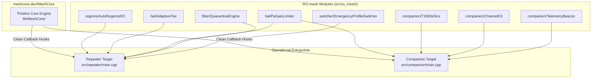

# RO-mesh Core Firmware

[](test/)
[](https://ancom.ro)
[](src/ro_mesh/switcher/PresetCutover.h)
[](src/ro_mesh/)
[](LICENSE)

Official downstream firmware for the **RO-mesh** network in Romania (`#ro`), built on top of [MeshCore](https://github.com/meshcore-dev/MeshCore). 

Designed with a **strictly decoupled zero-conflict architecture**, this firmware keeps the upstream engine completely untouched as a submodule, while delivering tailored national geofencing, regulatory power limits for 1W boards, physics-accurate repeating delay tiers, rogue node flood quarantine, single-use token emergency profiles, and an app-agnostic conversational assistant for companions.

---

## Table of Contents

- [Architectural Decoupling](#architectural-decoupling)
- [Hardware Target Matrix](#hardware-target-matrix)
- [Repeater Subsystems](#repeater-subsystems)
  - [AutoRegionsRO & Geographic Fallback](#1-autoregionsro--geographic-fallback)
  - [AdaptiveTier Delay Engine](#2-adaptivetier-delay-engine)
  - [Universal PA Gain Limiter](#3-universal-pa-gain-limiter)
  - [Airtime Token Bucket & Quarantine Engine](#4-airtime-token-bucket--quarantine-engine)
  - [BatteryGate Voltage Protection](#5-batterygate-voltage-protection)
  - [Emergency Profile Switcher (RO-mesh Sentry)](#6-emergency-profile-switcher-ro-mesh-sentry)
  - [Deterministic Outbound Adverts](#7-deterministic-outbound-adverts)
- [Companion Subsystems](#companion-subsystems)
  - [T1000-E SOS Hardware Engine](#1-t1000-e-sos-hardware-engine)
  - [Conversational System Assistant](#2-conversational-system-assistant-channelcli)
  - [Smart Telemetry Beaconing](#3-smart-telemetry-beaconing)
  - [Pre-Populated Default Channels](#4-pre-populated-default-channels)
- [Command Reference Guide](#command-reference-guide)
  - [In-Chat Slash Commands (Companions)](#in-chat-slash-commands-companions)
  - [Serial CLI Commands (Repeaters & Console)](#serial-cli-commands-repeaters--console)
- [Building and Flashing](#building-and-flashing)
- [Upstream Synchronization Playbook](#upstream-synchronization-playbook)
- [Running Native Unit Tests](#running-native-unit-tests)

---

## Architectural Decoupling

To ensure zero merge conflicts and seamless rebasing against future upstream releases, all custom logic is isolated in `src/ro_mesh/`, `src/repeater/`, and `src/companion/`. The upstream `lib/MeshCore` repository remains 100% pristine.



---

## Hardware Target Matrix

| Environment | Board / Target | MCU | Radio / FEM | Role |
| :--- | :--- | :--- | :--- | :--- |
| `t1000e_companion` | Seeed SenseCAP T1000-E | Nordic nRF52840 | Semtech LR1110 / SX1262 | Mobile Companion / SOS / GPS |
| `heltec_v3_repeater` | Heltec LoRa32 V3 | ESP32-S3 | Semtech SX1262 (Standard) | Stationary Infrastructure Repeater |
| `rak_1w_repeater` | RAK4631 + RAK13300 | Nordic nRF52840 | SX1262 + 1000mW PA (+14 dB) | High-Power Backbone Repeater |
| `tbeam_1w_repeater` | LilyGo T-Beam 1W | ESP32-S3 | SX1262 + 1000mW PA (+14 dB) | High-Power Backbone Repeater |
| `native_test` | Host Workstation (Linux/macOS) | Native x86_64 | Mock Radio / Simulator | Automated CI & Verification |

---

## Repeater Subsystems

### 1. AutoRegionsRO & Geographic Fallback
Repeaters operating in Romania must flood packets deterministically within regional boundaries (`#europe` &rarr; `#ro` &rarr; macro-region &rarr; county).
* **8 Macro-Regions**: `ro-nord-vest`, `ro-centru`, `ro-nord-est`, `ro-sud-est`, `ro-sud-muntenia`, `ro-b-if`, `ro-sud-vest-oltenia`, `ro-vest`.
* **42 County Identifiers**: Centroid and bounding-box coordinates for all 41 Romanian counties plus București (`ro-b`).
* **Name Prefix Parser**: When onboard GPS is unset (`0.0, 0.0`), parses standard vehicle prefixes (e.g. `RO-BV-01` &rarr; Brașov `ro-bv`, `RO-CJ-REP` &rarr; Cluj `ro-cj`).
* **Safe National Fallback**: If coordinates are missing and the node name is arbitrary (e.g. `MyRepeaterAlpha`), automatically defaults to national scope `#ro` and posts a system notice to prevent packet drops.

### 2. AdaptiveTier Delay Engine
Because MeshCore Narrow mode (62.5 kHz BW) incurs airtimes of 250–750+ ms per packet, repeating delays must be calibrated in **seconds** to prevent devastating on-air collisions:
* **Tier 0 (Mountain-Top Backbone)**: `rxdelay: 3.0s`, `txdelay: 2.0s` &mdash; Strategic mountain nodes fire first, establishing cross-county paths.
* **Tier 1 (Regional Relay)**: `rxdelay: 3.0s`, `txdelay: 1.2s` &mdash; Hilltops and tall regional structures fill coverage gaps.
* **Tier 2 (Local Suburban)**: `rxdelay: 3.0s`, `txdelay: 0.6s` &mdash; Standard urban and neighborhood repeaters.
* **Tier 3 (Dense Urban Edge)**: `rxdelay: 3.0s`, `txdelay: 0.3s` &mdash; Ground-level relays yield priority to avoid jamming backbones.
* **Adaptive Sliding Window**: Automatically categorizes the node using three 5-minute buckets (15-minute rolling window) evaluating neighbor counts, duplicate ratios, and average SNR with 2-cycle hysteresis.

### 3. Universal PA Gain Limiter
European CEPT regulations limit effective radiated power (ERP) in the 869.4–869.65 MHz sub-band to **+27 dBm (500 mW)**, with conducted power at the connector typically restricted to +22 dBm.
* Boards with built-in power amplifiers (LilyGo T-Beam 1W, RAK 1W, Heltec T096 PA) add up to +14 dB of analog gain.
* The limiter automatically attenuates the transceiver drive level:
  $$\text{SX1262 Drive Level (dBm)} = \min\left(\text{Target Power}, \text{Legal Conducted Limit} - \text{PA Gain (dB)}\right)$$
  For a +22 dBm conducted limit with a +14 dB PA, transceiver drive is clamped to **+8 dBm**.
* Disabling the limiter is possible via CLI for licensed amateur radio operators (`set pa.limiter off`).

### 4. Airtime Token Bucket & Quarantine Engine
Protects the Romanian mesh against boot-loop storms, misconfigured nodes, and malicious flooding:
* **Mathematical Token Bucket**: Models continuous channel airtime with a 10% CEPT sub-band duty cycle.
* **24-Hour Remote Advert Limiting**: Foreign nodes and non-RO-mesh firmwares repeating adverts are strictly rate-limited to **one relay per 24 hours**, preserving local neighbor tables while eliminating advert storms.
* **Automatic 60-Minute Quarantine**: Nodes exceeding their airtime token balance or emitting more than 5 adverts in 15 minutes have their public key placed in temporary quarantine; all packets from them are dropped at the MAC filter level.

### 5. BatteryGate Voltage Protection
Stationary solar repeaters feature monitored LiPo voltage hysteresis:
* **Cut-Off (3.40V)**: Repeaters suspend transmit forwarding and switch to passive receive-only mode, protecting battery chemistry and avoiding brownout boot loops.
* **Recovery (3.60V)**: Automatically resumes packet relaying once solar charging elevates voltage past the threshold.

### 6. Emergency Profile Switcher (RO-mesh Sentry)
Enables coordinated remote radio frequency and parameter cutovers in tactical or contested environments:
* **Anti-Replay Protection**: Replay-proof disposable single-use tokens ("burn-after-reading", up to 10 stored in NVS).
* **Inconspicuous Steganographic Formats**:
  * *Weather Telemetry*: `WX: Temp <val>, Hum <val>, Stn# <preset_id>-<token>`
  * *Routine Check-In*: `chk <preset_id> <token> [arbitrary chatter]`
  * *Direct Command*: `!id <job> !preset <id>`
* **Narrow Sub-Band Presets** (All on official `869.618 MHz` Narrow frequency):
  * **Preset 1 (Official MeshCore Narrow)**: `869.618 MHz`, SF8, BW 62.5 kHz, CR 4/8 (+22 dBm)
  * **Preset 2 (Narrow Balanced)**: `869.618 MHz`, SF8, BW 62.5 kHz, CR 4/5 (+22 dBm)
  * **Preset 3 (Narrow Fast)**: `869.618 MHz`, SF7, BW 62.5 kHz, CR 4/5 (+22 dBm)

### 7. Deterministic Outbound Adverts
Rather than broadcasting node presence on random timers or colliding at round hourly marks, repeaters calculate a deterministic transmission slot in a **23-hour rolling window** derived from `FNV-1a(pubkey)`. This guarantees predictable presence announcements without synchronized network collisions.

---

## Companion Subsystems

### 1. T1000-E SOS Hardware Engine
Engineered specifically for field safety on the Seeed SenseCAP T1000-E:
* **Double-Click Arming**: Two short presses within 600 ms transitions the device into `ARMED_COUNTDOWN`.
* **15-Second Audible Countdown**: Buzzer chirps with escalating frequencies (1500 Hz to 2800 Hz) to alert the user of accidental activation.
* **5-Second Long Hold Disarm**: To eliminate conflict with the T1000-E factory triple-click (which toggles GPS), disarming is mapped to holding the button for **5 consecutive seconds**.
* **Dual-Target Dispatch**: Transmits periodic emergency beacons containing GPS coordinates, altitude, battery percentage, and a Google Maps URL to `#sos` and all configured direct emergency contacts.
* **Resolution Broadcast**: Disarming after activation transmits `[SOS-RESOLVED] <callsign>: Emergency cleared`.

### 2. Conversational System Assistant (ChannelCLI)
Eliminates the need for serial cables or custom mobile apps by embedding a virtual companion in chat:
* **Virtual "System" Contact**: A deterministic contact (`0x53, 0x59, 0x53, 0x54...`) named **`System`** is pre-seeded in the device contact table.
* **Zero RF Airtime**: All messages and slash commands sent to `System` or the dedicated `RO-mesh T1000E CLI` channel are intercepted locally before hitting the radio.
* **Automated Welcome Greeting**: Welcomes the user on first connection and offers `/help`.
* **Proactive System Alerts**: Pushes battery alerts, GPS status changes, and AutoRegions fallbacks directly into the `System` chat.

### 3. Smart Telemetry Beaconing
* **Movement-Triggered**: Transmits position updates when movement exceeds **100 meters** (calculated via Haversine formula) and cooldown has elapsed.
* **Heartbeat Fallback**: Transmits periodic telemetry every 15 minutes.
* **Strict Public Channel Bar**: Automatic telemetry is **strictly barred from the global `Public` channel** to safeguard mesh airtime; routed to `#romania` by default.

### 4. Pre-Populated Default Channels
On first boot, the firmware auto-provisions standard channels into flash memory:
1. **`Public`**: Official MeshCore Global Public Channel (PSK: `8b3387e9c5cdea6ac9e5edbaa115cd72`).
2. **`#romania`**: National Romanian chat channel.
3. **`#sos`**: National emergency & search-and-rescue channel.
4. **`#alerte`**: Civil defense and severe weather alerts.
5. **`RO-mesh T1000E CLI`**: Dedicated in-chat CLI channel.

---

## Command Reference Guide

### In-Chat Slash Commands (Companions)
Type these commands directly into the **`System`** chat contact or in any local message:

| Command | Arguments | Description | Example |
| :--- | :--- | :--- | :--- |
| `/help` | - | Displays full command list and descriptions | `/help` |
| `/status` | - | Node health, scope, battery, GPS fix, tier, and PA status | `/status` |
| `/tier` | `[0-3\|auto\|off]` | Inspects or locks repeating delay tier | `/tier auto` |
| `/sos` | `[trigger\|cancel\|status]` | Software trigger or cancellation of emergency SOS | `/sos trigger` |
| `/telemetry`| `[on\|off\|status]` | Toggles or checks position beaconing | `/telemetry status` |
| `/battery` | - | Displays battery percentage and voltage | `/battery` |
| `/gps` | - | GPS coordinates, altitude, satellites in view, and map link | `/gps` |
| `/pa` | - | PA Gain Limiter active status and power clamp levels | `/pa` |
| `/info` | - | Firmware version, git commit, and license details | `/info` |

### Serial CLI Commands (Repeaters & Console)
Execute over USB Serial (`115200 baud`) on repeaters and nodes:

| Subsystem | Command | Description |
| :--- | :--- | :--- |
| **Tier** | `get tier` | Displays current mode, active tier, and exact delay seconds |
| **Tier** | `set tier auto` | Enables adaptive 15-minute sliding window calculation |
| **Tier** | `set tier <0-3>` | Locks tier manually (e.g. `set tier 0` for backbone) |
| **Tier** | `set tier off` | Disables tier delays (reverts to stock defaults) |
| **PA Limiter**| `set pa.limiter on\|off` | Enables or bypasses the PA attenuation limiter |
| **PA Limiter**| `set pa.gain <dB>` | Sets hardware front-end PA gain (e.g. `set pa.gain 14`) |
| **Quarantine**| `ban list` | Lists all active node quarantines and remaining seconds |
| **Quarantine**| `ban add <hex> <min>` | Manually bans a public key prefix (e.g. `ban add A1B2C3D4 120`) |
| **Quarantine**| `ban del <hex>` | Removes a manual or automatic quarantine |
| **Filter** | `get filter.stats` | Shows counts of forwarded packets, battery drops, and bans |
| **Filter** | `set filter.maxhops <h>`| Sets maximum hop count (default: 7) |
| **Sentry** | `sentry status` | Displays active preset, monitored channel, and burned tokens |
| **General** | `status` | Summarizes active scope, tier, battery voltage, and relay state |

---

## Building and Flashing

This project utilizes [PlatformIO](https://platformio.org).

### 1. Build Targets

```bash
# Clone repository with submodules
git clone --recursive https://github.com/RO-mesh/core-firmware.git
cd core-firmware

# Build Seeed SenseCAP T1000-E Companion
pio run -e t1000e_companion

# Build Heltec LoRa32 V3 Repeater
pio run -e heltec_v3_repeater

# Build RAK4631 1W High-Power Repeater
pio run -e rak_1w_repeater

# Build LilyGo T-Beam 1W High-Power Repeater
pio run -e tbeam_1w_repeater
```

### 2. Flashing to Hardware

```bash
# Upload to connected board (e.g. Heltec V3)
pio run -e heltec_v3_repeater -t upload

# Upload via DFU / UF2 for nRF52 targets (T1000-E, RAK)
pio run -e t1000e_companion -t upload
```

---

## Upstream Synchronization Playbook

To keep `RO-mesh Core Firmware` updated with the latest improvements from upstream `meshcore-dev/MeshCore` without breaking downstream customizations:

```bash
# Execute automated synchronization script
./scripts/sync-upstream.sh
```

The script performs the following:
1. Pulls the latest commits from `https://github.com/meshcore-dev/MeshCore` `main` branch into `lib/MeshCore`.
2. Compiles the native C++ test suite against the updated engine.
3. Runs regression tests to ensure all hooks, filters, and callbacks remain 100% operational.

---

## Running Native Unit Tests

Unit tests run natively on Linux or macOS without hardware dependencies:

```bash
# Compile and run test runner
mkdir -p build
g++ -std=c++17 -w \
  -I test \
  -I src \
  -I src/ro_mesh \
  -I lib/MeshCore/src \
  test/test_all.cpp \
  test/mock_region_map.cpp \
  src/ro_mesh/regions/AutoRegionsRO.cpp \
  src/ro_mesh/hal/AdaptiveTier.cpp \
  src/ro_mesh/hal/PaGainLimiter.cpp \
  src/ro_mesh/filter/QuarantineEngine.cpp \
  src/ro_mesh/filter/BatteryGate.cpp \
  src/ro_mesh/filter/PacketFilter.cpp \
  src/ro_mesh/switcher/PresetCutover.cpp \
  src/ro_mesh/switcher/EmergencyProfileSwitcher.cpp \
  src/ro_mesh/advert/DeterministicAdverts.cpp \
  src/ro_mesh/companion/T1000eSos.cpp \
  src/ro_mesh/companion/ChannelCli.cpp \
  src/ro_mesh/companion/TelemetryBeacon.cpp \
  src/ro_mesh/companion/MessageStore.cpp \
  -o build/test_runner && ./build/test_runner
```

---

## GitHub Pages & Documentation

An interactive showcase of the firmware with live delay calculators, region maps, and command reference is published at:  
👉 **[https://ro-mesh.github.io/core-firmware/](https://ro-mesh.github.io/core-firmware/)**

---

## License

Derived from [MeshCore](https://github.com/meshcore-dev/MeshCore). Distributed under the GNU General Public License v3.0 (or matching upstream license).
